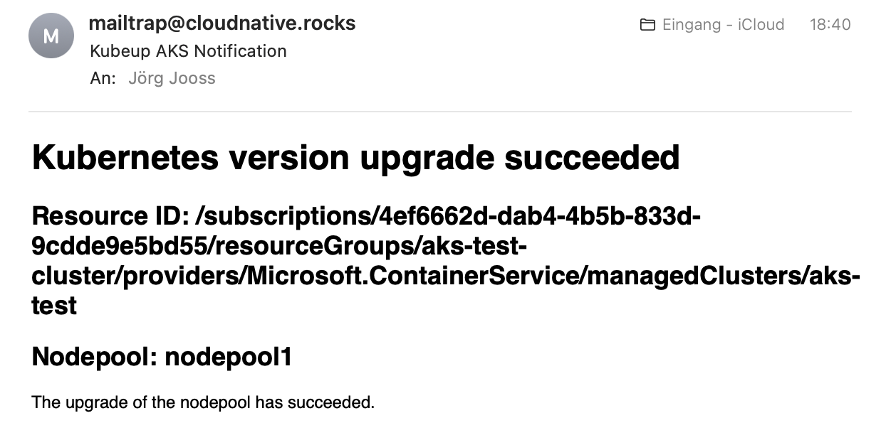
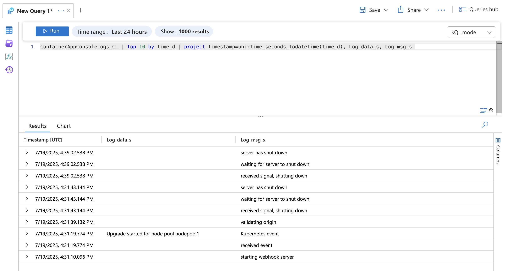

# Deployment
`kubeup` can be configured for different event delivery methods and security options.

Before deploying, choose your configuration options. For a quick start, follow the [quickstart guide](./quickstart.md) and return here for advanced configuration.

## Event delivery options
All delivery options can be combined. Event logging is enabled by default.

### Log to stderr
`kubeup` writes all events to stderr. With the provided Bicep templates, Azure Monitor diagnostic settings forward Container Apps system, console, and HTTP logs to a Log Analytics workspace. These are stored in the `ContainerAppSystemLogs`, `ContainerAppConsoleLogs`, and `ContainerAppHTTPLogs` resource-specific tables. On other platforms, use any log shipping solution.

### SMTP delivery
Send events as emails using SMTP. [Mailtrap](https://mailtrap.io) offers a free tier that works well with `kubeup`.



### Twilio SendGrid
Send events as emails using [Twilio SendGrid's email API](https://www.twilio.com/products/email-api). SendGrid no longer offers free plans.

## Authorization options
Authorization options are mutually exclusive. If both client secrets and Entra ID are configured, Entra ID takes precedence.

### No Authorization
Unauthenticated operation requires explicit development opt-in with `-insecure` or `KU_DEV=true` (or `1`). Without credentials or opt-in, startup fails. Anyone who knows an insecure webhook endpoint can trigger it; do not use this mode in production. The supplied Azure deployment templates do not enable insecure mode.

### Client Secrets
Requires two secrets that can be used interchangeably. This enables seamless key rotation by replacing one key at a time without service disruption. The sender must include one key as a query parameter when calling the webhook.

### Entra ID Authorization
Validates that the sender has a valid Entra ID access token with the correct role claim. This is the **recommended** and most secure authorization method.

**Note:** Setting up Entra ID authorization requires specific Entra ID privileges often not granted to end users or developers. [See below](#deploy-with-entra-id-authorization) for details.

## Prerequisites
To deploy `kubeup` to Microsoft Azure:

1. **Azure subscription** - Sign up [for free](https://azure.microsoft.com/free/)
2. **Bash environment** - Available on macOS/Linux. On Windows 10/11, install [Windows Subsystem for Linux](https://docs.microsoft.com/windows/wsl/install)
3. **[Task](https://taskfile.dev)** - For running build and deployment steps
4. **[Azure CLI](https://docs.microsoft.com/cli/azure/install-azure-cli)** - For deploying Bicep templates
5. **[Bicep CLI](https://learn.microsoft.com/azure/azure-resource-manager/bicep/install#azure-cli)** - Install with `az bicep install`
6. **Email service** (optional) - [Twilio SendGrid account](https://sendgrid.com/pricing/) or SMTP access for email notifications
7. **[jq](https://jqlang.org/download/)** and **`uuidgen`** (optional) - Required for Entra ID setup. macOS includes `uuidgen`; on Linux it is commonly provided by the `uuid-runtime` package.

Alternatively, use the Bash environment in [Azure Cloud Shell](https://shell.azure.com). Entra ID setup uses Azure CLI's `az rest` command to call Microsoft Graph v1.0; no separate Graph command-line tool is required.

## Deployment steps

### Create an AKS cluster (optional)
If you don't have an AKS cluster, create one using the included script. Adjust the names and region as needed:

```bash
# Set variables in .env file first
cp .env.template .env
# Edit .env with your cluster details
task deploy:aks
```

>Note: The provided instructions assume that your cluster and the `kubeup` resources are deployed in the same Azure region. This is just to keep things simple. You can run `kubeup` in any public Azure region.

### Prepare the `.env` file
Copy the template and configure for your deployment:

```bash
cp .env.template .env
```

See the [configuration guide](./configuration.md) for required settings, then continue with deployment.

### Deploy kubeup
Deploy `kubeup` using the included Bicep templates. This creates both the Azure Container App and Event Grid subscription for your AKS cluster events.

#### Deploy with client secrets
```bash
task deploy:azure
```

#### Deploy with Entra ID authorization
Sign in interactively to Azure CLI in the tenant containing the webhook and Event Grid subscription:
```bash
tenant_id="Your Entra ID tenant ID"
az login --tenant "$tenant_id"
az account show --query '{tenant:tenantId, subscription:id, identity:user.type}'
```

The script uses the active Azure CLI login for Microsoft Graph requests and accepts only a signed-in user, not a service-principal or managed-identity login. Select the correct subscription with `az account set --subscription <subscription-id>` before deployment. If you use a separate `AZURE_CONFIG_DIR`, use the same context for login and deployment.

**Entra permissions:** Azure subscription Contributor/Owner permissions do not grant directory permissions. The complete setup creates applications and service principals, updates app roles, and grants the webhook role to both your user and Event Grid. `Application Developer` alone is not sufficient for all of these operations. An Entra administrator should verify that your user has a supported role, such as Application Administrator or Cloud Application Administrator, and that tenant policies permit these actions.

Microsoft Graph's [role-assignment API](https://learn.microsoft.com/graph/api/serviceprincipal-post-approleassignedto?view=graph-rest-1.0) also requires delegated authorization for `AppRoleAssignment.ReadWrite.All` and application read/write access; application updates require `Application.ReadWrite.All`, and `/me` requires user-read access. Azure CLI obtains its own Graph token automatically: signing in is not a way to grant arbitrary Graph permissions or administrator consent. If a request is forbidden, ask your Entra administrator to review both directory privileges and the Azure CLI client's Graph authorization.

Deploy everything:
```bash
task deploy:all
```

#### Deploy only Entra ID components
Creates required Entra ID objects and role assignments. Same prerequisites as above apply.

```bash
task deploy:entraid
```

Setup saves the application ID to the repository-root `.env.entraid` only after both role assignments succeed. Subsequent runs reuse that file without Graph calls. Failures return a nonzero exit code, with diagnostics on stderr and progress in `deploy/entraid.log`. To resume an interrupted setup without creating another application, run `./entraid.sh <application-client-id>` from `deploy/`. Existing principals and assignments are reused, and unrelated app roles are preserved.

Setup currently targets the public Azure cloud and interactive user authentication only.

### Verification
After `kubeup` has been deployed, it may take some time before you will receive notifications, depending on when new Kubernetes version become available or when you upgrade your cluster to a newer Kubernetes version. 

If you want to test `kubeup` right away, trigger a Kubernetes update to the latest version offered by AKS and check the logs. 

```bash
version=$(az aks get-upgrades -n $KU_AKS_CLUSTER -g $KU_AKS_RESOURCE_GROUP \
  --query 'controlPlaneProfile.upgrades[].kubernetesVersion' -o tsv | sort | head -1)
az aks upgrade -n $KU_AKS_CLUSTER -g $KU_AKS_RESOURCE_GROUP -k $version -y
```

Once Kubernetes events are published for your AKS cluster, you will receive emails (if configured) and log entries in your Log Analytics workspace's `ContainerAppConsoleLogs` table.



Query the most recent application logs and parse structured JSON written to stdout or stderr:

```kusto
ContainerAppConsoleLogs
| top 10 by TimeGenerated desc
| extend LogData = parse_json(Log)
| project TimeGenerated, ContainerAppName, RevisionName, LogData
```